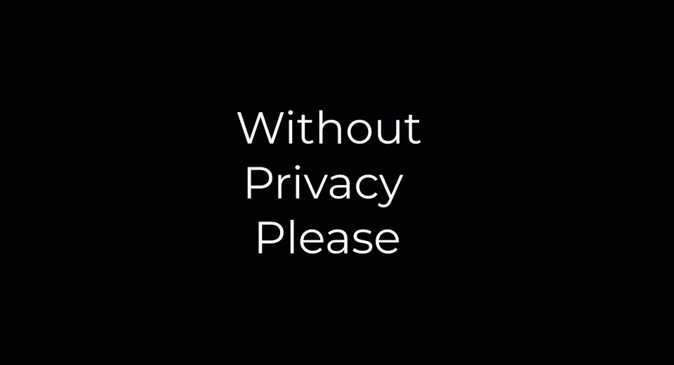

**Privacy Please** is a browser extension that automatically redirects users from major websites to privacy-respecting frontend alternatives. Instead of feeding surveillance capitalism, you get clean access to content without tracking, ads, or engagement profiling.

## Enabling/disabling specific sites and changing instances (Youtube video👇🏻)

---
## Comparison Before and After

## 🔒 What It Does

When you navigate to sites like YouTube, Reddit, Twitter/X, or Google, the extension intercepts the request and redirects you to an open-source frontend. Same content, zero tracking.

Examples:
- YouTube → Invidious
- Twitter/X → Nitter
- Reddit → RedLib
- Google Search → SearXNG
- TikTok → ProxiTok

The extension supports multiple frontends for each service. You can pick your preferred instance or disable redirection for specific platforms entirely.

---

## ✅ Features

- Seamless redirection from centralized platforms to FOSS frontends
- User-configurable instance selection per service
- Enable/disable individual redirect rules from the UI
- Lightweight and fast — no telemetry, no bloat
- Open-source under GPL-3.0

---

## 🔧 Supported Frontends

| Original Site  | Privacy Frontend | Example Instance |
|----------------|------------------|------------------|
| YouTube        | Invidious        | `https://yewtu.be` |
| Twitter/X      | Nitter           | `https://nitter.net` |
| Reddit         | RedLib           | `https://redlib.catsarch.com` |
| TikTok         | ProxiTok         | `https://proxitok.herokuapp.com` |
| Instagram      | Proxigram        | `https://proxigram.herokuapp.com` |
| Google Search  | SearXNG          | `https://searx.space` |
| Medium         | Scribe           | `https://scribe.rip` |
| Facebook (Firefox only) | Mobile site, still Facebook | `https://m.facebook.com` |
| YouTube Music  | Beatbump         | `https://beatbump.io` |
| Imgur          | Rimgo            | `https://rimgo.bus-hit.me` |

---

## 🚀 Installation

### 🦊 Firefox

Install it from [Firefox Add-ons](https://addons.mozilla.org/en-US/firefox/addon/privacy-please/).

To run it from source, clone this repository, open `about:debugging#/runtime/this-firefox`, choose "Load Temporary Add-on…" and select `firefox/privacy-please-firefox/manifest.json`.

---

### 🧩 Chrome / Chromium

Install it from the [Chrome Web Store](https://chromewebstore.google.com/detail/privacy-please/pelceacokglomngpmedefbnlmmmpnlea).

To run it from source, clone this repository, open `chrome://extensions`, turn on Developer mode, choose "Load unpacked" and select the `chrome/privacy-please-chrome` folder.

---

## 🛡️ Why This Matters

Most modern websites aren't just content platforms — they’re surveillance machines. Even without logging in, you’re being profiled. This extension bypasses the platform’s frontend entirely, reducing your exposure to:

- Tracking cookies
- Behavioral analytics
- Fingerprinting
- Ad targeting
- UI dark patterns

Instead of patching the surveillance model, this extension replaces it at the source.

---

## 🔊 Announcement Video

---

## 🧪 Development

Chrome reads its redirect rules from `chrome/privacy-please-chrome/rules.json` (declarativeNetRequest). The per-site defaults and instance lists are in `js/background.js` in each extension. Firefox does the redirecting in `firefox/privacy-please-firefox/js/background.js`, so rules and instances are in the same file there. After editing, reload the extension from `chrome://extensions` or `about:debugging`.

---

## Licence

Privacy Please is released under the GNU General Public License v3.0. See [LICENSE](LICENSE). The instance lists draw on the [LibRedirect](https://github.com/libredirect/instances) project's lists. Thanks to 924312 for contributions.
